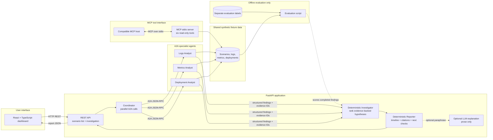
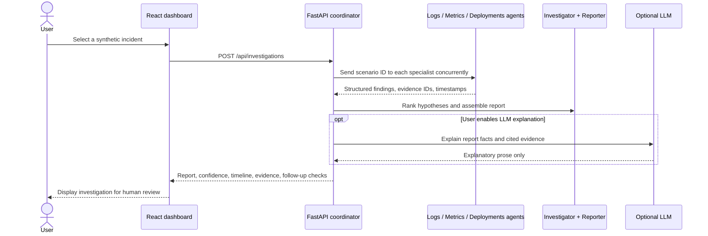

# Incident Response Copilot

**A synthetic, read-only SRE investigation demo.** A coordinator delegates to specialist agents over the A2A protocol. Their evidence comes from read-only MCP tools and deterministic fixture analysis; a deterministic investigator ranks hypotheses and produces a source-backed report. An optional LLM can paraphrase that report, but cannot alter metrics, facts, or the ranked result.

> This is a portfolio demonstration. It does not connect to production systems, execute remediation, or establish the cause of a real outage. All bundled telemetry is synthetic.

Incident Response Copilot demonstrates how to combine **agent-to-agent delegation, controlled tool access, deterministic analysis, and an optional language model** in an operations workflow. It is designed for engineers who want to explore agent architecture without connecting a prototype to live infrastructure. Select a simulated incident, let the specialist agents inspect their respective evidence sources, then review the ranked hypotheses and trace each conclusion back to fixture IDs and timestamps.

The project emphasizes a practical reliability principle: use code for measurable facts and decision rules, and use an LLM only where natural-language explanation adds value. The investigation remains usable when no model key is configured, and the report clearly marks its leading cause as a hypothesis for a human to verify.

## What it demonstrates

- Multi-agent design: Logs, Metrics, and Deployments specialists; a coordinator; deterministic Investigator and Reporter stages.
- **A2A**: official A2A Python SDK 1.2.x Agent Cards and JSON-RPC `message/send` endpoints. The coordinator makes three concurrent A2A calls and receives structured findings.
- **MCP**: official Python SDK 2.x server over stdio, exposing six read-only incident/log/metric/deployment tools.
- **FastAPI + React + TypeScript**: REST API plus an investigation dashboard with agent findings, ranked hypotheses, timeline, evidence, and suggested next checks.
- Optional OpenAI explanation. It is disabled by default; all scenarios run without a model or key.
- Three repeatable synthetic scenarios and a measurable evaluation script.

## Architecture



### Investigation flow



The specialists are independently discoverable A2A agents. Their cards are served at `/a2a/{agent}/.well-known/agent-card.json`; JSON-RPC endpoints are `/a2a/logs`, `/a2a/metrics`, and `/a2a/deployments`. The coordinator sends each agent a scenario ID through A2A JSON-RPC and gathers the three responses concurrently. Each response contains structured findings with source IDs and timestamps. In this demo the specialists are deterministic Python agents, not separate LLMs; this keeps the example reproducible while demonstrating protocol-based delegation.

The investigator applies explicit rules to the findings and ranks candidate causes. It never reads the fixture's hidden `expected_cause` label. The reporter combines findings into a chronological report with citations, heuristic confidence, and safe follow-up checks. The evaluation runner reads expected labels separately to score the investigation; those labels are not exposed through the API or MCP tools.

MCP is a separate stdio server for tool hosts. It exposes `list_incidents`, `get_incident`, `search_logs`, `summarize_error_signatures`, `inspect_metrics`, and `recent_deployments`. Log search accepts optional ISO-8601 start/end times, service, log level, and text filters. These tools have no write operations. MCP inspection is useful independently; A2A is used for the agent-to-agent delegation flow. After A2A delegation, deterministic Investigator rules rank the candidate causes and Reporter assembles citations, timeline, confidence, and safe follow-up checks.

### Component responsibilities

| Component | Responsibility | Interface / source |
| --- | --- | --- |
| React dashboard | Choose a scenario, request an investigation, and present findings, evidence, and the timeline | `frontend/src/` → FastAPI REST |
| FastAPI application | Serve scenarios, health checks, investigation requests, and A2A routes | `app/main.py` |
| Coordinator | Call the three specialists concurrently and pass their structured results to the rules engine | `app/orchestrator.py` |
| Specialist agents | Analyze logs, metrics, or deployment timing; return evidence with stable IDs | `app/agents.py`, A2A JSON-RPC |
| Investigator and Reporter | Rank hypotheses and assemble a cited, chronological report | `app/investigation.py` |
| MCP server | Offer six read-only inspection tools to MCP-compatible clients | `app/mcp_server.py`, stdio |
| Synthetic fixtures | Provide repeatable incident data for the UI, agents, and MCP tools | `data/scenarios.json` |
| Evaluation set | Score cause, required evidence, provenance, and timeline correctness outside the investigation flow | `data/evaluations/cases.json` |

### Design boundaries

- **Evidence stays inspectable:** report evidence includes stable fixture IDs, timestamps, source types, and excerpts.
- **Diagnosis stays reproducible:** hypothesis ranking uses explicit rules; confidence is a normalized heuristic rather than a calibrated probability.
- **LLM scope stays narrow:** the optional model explains the supplied report and cannot replace or edit the deterministic findings.
- **Tools stay read-only:** neither MCP nor A2A offers production access or remediation actions.
- **Evaluation stays separate:** expected causes are available to the scoring script, not to the diagnosis agents or public API.

## Requirements

- Python 3.11+, [uv](https://docs.astral.sh/uv/), Node.js 20.19+ and npm.
- Optional: an OpenAI API key if you select the natural-language explanation option. No key is needed for the deterministic investigation.

## Run locally

Open two terminals in this project directory.

### 1. Install and start the API

```bash
uv sync --extra dev
uv run python -m uvicorn app.main:app --reload --host 127.0.0.1 --port 8000
```

API docs: <http://127.0.0.1:8000/docs>. Health: `GET /api/health`.

### 2. Install and start React

```bash
cd frontend
npm install
npm run dev
```

Open <http://127.0.0.1:5173>. Choose one of the three incident cards and select **Run investigation**. The API coordinator calls the three local A2A agents over HTTP, then returns the combined deterministic report.

### 3. Optional MCP host

Run `uv run python -m app.mcp_server` as an MCP stdio process, or add this entry to an MCP host configuration (adjust the absolute project path):

```json
{
  "mcpServers": {
    "incident-response-copilot": {
      "command": "uv",
      "args": ["--directory", "C:/path/to/incident-response-copilot", "run", "python", "-m", "app.mcp_server"]
    }
  }
}
```

The stdio process expects an MCP-compatible host; it is not a browser endpoint. Tools only inspect the bundled synthetic fixtures.

### 4. Optional LLM paraphrase

Install the optional dependency with `uv sync --extra llm`, copy `.env.example` to `.env`, add your own `OPENAI_API_KEY`, then start the API with `uv run --env-file .env python -m uvicorn app.main:app --reload --host 127.0.0.1 --port 8000`. In the UI select **Optional LLM explanation**. The API returns the same deterministic report plus an explanation field; if the model is not configured or unavailable, the deterministic report still appears. Never send production telemetry or secrets to a model.

## Deploy to Render

The repository includes a Render Blueprint and a multi-stage `Dockerfile`. The Docker build compiles the React frontend, installs the locked Python dependencies, and packages both into one web service. FastAPI serves the built dashboard and API from the same origin; the A2A Agent Cards advertise Render's public URL while the coordinator calls the agents on the service's local listener.

1. Open [Create a Render Blueprint](https://dashboard.render.com/blueprint/new?repo=https%3A%2F%2Fgithub.com%2FYuussef%2Fincident-response-copilot) and sign in to Render.
2. Connect the `Yuussef/incident-response-copilot` repository and select its `main` branch.
3. Review the `incident-response-copilot` service from `render.yaml`, then create the Blueprint.
4. Wait for the Docker build and deployment to finish. Open the generated `onrender.com` URL; `/api/health` should return `{"status":"ok",...}`.
5. Run an investigation from the dashboard. The free instance may sleep after inactivity and take a little while to wake on its next request.

The deterministic demo needs no environment secrets. The optional LLM explanation stays unavailable unless you add `OPENAI_API_KEY` (and optionally `OPENAI_MODEL`) in the Render service's environment settings. Pushing commits to `main` triggers a new deployment.

## Scenarios and expected results

| ID | Synthetic signal | Expected top hypothesis |
| --- | --- | --- |
| `deployment-regression` | Error spike after release `2.8.1`, stable traffic, null currency errors | `deployment_regression` |
| `dependency-outage` | Provider timeouts and circuit breaker, no nearby deployment | `external_dependency_degradation` |
| `traffic-surge` | Request volume jumps from ~950 to >4,000/min, worker queue warnings | `traffic_capacity_saturation` |

Fixture details are in `data/scenarios.json`. The expected causes and required citation IDs live separately in `data/evaluations/cases.json`, so investigation agents never receive answer labels.

## Example API

```bash
curl -X POST http://127.0.0.1:8000/api/investigations \
  -H 'Content-Type: application/json' \
  -d '{"scenario_id":"deployment-regression"}'
```

The response includes a leading hypothesis, confidence, five agent-stage summaries, source-backed evidence (`id`, `timestamp`, `source`, `excerpt`), a chronological view, and safe follow-up checks. Example request and expected response summary are in `examples/`. For direct A2A discovery, fetch `http://127.0.0.1:8000/a2a/logs/.well-known/agent-card.json`. A2A JSON-RPC endpoints are available at `/a2a/logs`, `/a2a/metrics`, and `/a2a/deployments`.

Example MCP tool input: `{"scenario_id":"dependency-outage"}` for `inspect_metrics` or `recent_deployments`; `search_logs` also accepts optional `level`, `service`, `query`, `start_time`, and `end_time`. Returned evidence carries fixture IDs and timestamps.

## Tests and evaluation

```bash
uv run python -m pytest
uv run python -m scripts.evaluate
npm --prefix frontend run build
```

The separate evaluation set reports cause accuracy, required evidence coverage, evidence provenance validity, and timeline validity across the known fixtures. CI runs backend tests, the evaluation, and a TypeScript production build. Current rule-based result on bundled cases is 3/3 for each metric; that is a tiny synthetic benchmark, not a real-world quality claim.

## Extend the demo

- Add a fixture object to `data/scenarios.json` with stable evidence IDs and a matching evaluator label.
- Implement a specialist in `app/investigation.py`, add it to `app/agents.py`, then include it in `app/orchestrator.py`'s delegation list. The deterministic Investigator and Reporter stages are in `app/investigation.py`.
- Add read-only MCP tools in `app/mcp_server.py`; document input/output and preserve evidence provenance.
- Add evaluation assertions or cases in `tests/` and `scripts/evaluate.py`.
- If connecting a real observability API later, use a least-privilege read-only credential, redact sensitive fields, set bounded query windows, and add authentication/rate limits before exposing the endpoint publicly.

## Limits and safety

- Data is synthetic, small, in-memory/static, and not representative of operational telemetry.
- Baselines use simple explicit comparisons; there is no statistical anomaly model, streaming ingestion, persistent task store, or incident lifecycle management.
- The coordinator uses A2A JSON-RPC locally. The MCP server exposes the same read-only domain services separately; both surfaces share the deterministic service layer.
- Confidence is a normalized heuristic score, not a calibrated probability. Use evidence and human review.
- The optional model only produces explanatory prose. The deterministic report remains authoritative and available without a model.
- No agent can roll back, restart, scale, page, change configuration, or execute commands.

## License

MIT. See [LICENSE](LICENSE).

## Official protocol references

- [MCP Python SDK](https://github.com/modelcontextprotocol/python-sdk) and [SDK documentation](https://py.sdk.modelcontextprotocol.io/).
- [A2A Python SDK](https://github.com/a2aproject/a2a-python) and [A2A specification](https://a2a-protocol.org/latest/specification/).
